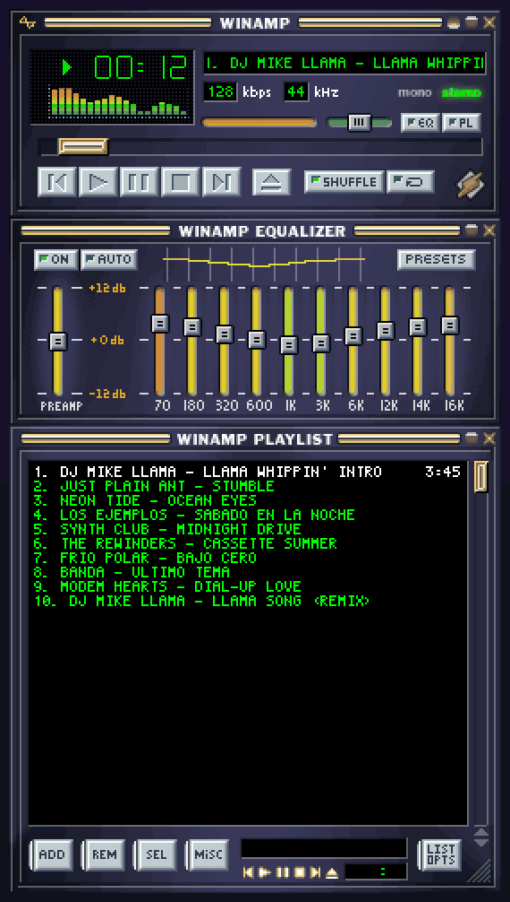

# C-EQ 3.0.1 — Winamp completo en tu pantalla de inicio

Primera versión pública de C-EQ: un ecualizador de 10 bandas para todo el teléfono, con espectro en vivo y los skins clásicos de Winamp 2 funcionando de verdad.

## ⬇️ Instalar
1. Descarga **C-EQ-3.0.1.apk** (abajo, en *Assets*). Requiere Android 8.0 o superior.
2. Ábrelo y permite instalar apps de esa fuente si Android lo pide.
3. Si tenías una versión anterior del Ecualizador, se instala encima sin perder tus ajustes.

SHA-256: `6e9157621ef767ecdb8ddb772da50082fb41c0f889508dc346de812bb234905d`

## ✨ Lo nuevo
### Winamp completo en el fondo de pantalla
- El skin hacia abajo, como en Winamp 2: **reproductor, ecualizador y lista de reproducción**.
- La lista muestra **la cola de lo que suena** (por ejemplo, la de Spotify) con la letra del propio skin. Tocar una canción salta a ella.
- El ecualizador del skin muestra **tus bandas reales**. Tócalas para cambiarlas; **ON** enciende el ecualizador y **AUTO** activa el ajuste automático.
- Fondo **multitáctil**: cada dedo cuenta y no se pierden toques seguidos. Con el cajón de apps abierto, los toques ya no llegan al reproductor.

### Ajuste automático sin micrófono
- La curva sigue sola al **equipo conectado**, a **lo que suena** (música, música con graves, acústica, voz o video) y al **volumen**.
- A poco volumen suma graves y agudos. A mucho volumen cuida los parlantes chicos y tus oídos.

### Además
- Reconoce audífonos y parlantes **Bluetooth LE Audio** y la TV por **HDMI**.
- El botón **aleatorio** se ve encendido en todos los skins.
- Los botones del **reproductor plegado de la notificación** ahora responden. Si habías desactivado esa notificación, sigue desactivada.
- **Créditos** y botón de **Ko-fi** dentro de la app.

## 🎨 Lo que ya traía
- 88 skins clásicos con su ventana real, y la opción de importar tus `.wsz`.
- Lo que suena en vivo, con botones, barra de posición y volumen funcionando.
- Reproductor de Winamp en la barra de notificaciones.
- Widget del espectro y mosaico de Ajustes rápidos.
- Un perfil por equipo, calibración con micrófono, preajustes y curvas GraphicEQ.

## 🔒 Permisos
- **Micrófono:** solo para leer la salida de audio y dibujar el espectro. No graba nada.
- **Acceso a notificaciones:** solo para saber qué suena y controlar el reproductor. No lee tus notificaciones.

---

**English:** System-wide 10-band equalizer for Android with a live spectrum and classic Winamp 2 skins. New in this release: a full Winamp stack (player, equalizer and playlist with your player's queue) as a live wallpaper, plus a mic-free automatic EQ that adapts to your device, content and volume. Download the APK below (Android 8.0+).

Skins belong to their authors ([CREDITS.md](https://github.com/CarmelitaSoftworks/C-EQ/blob/main/CREDITS.md)). Code under GPL-3.0. If you like it, [support it on Ko-fi ☕](https://ko-fi.com/carmelitasoftworks).
