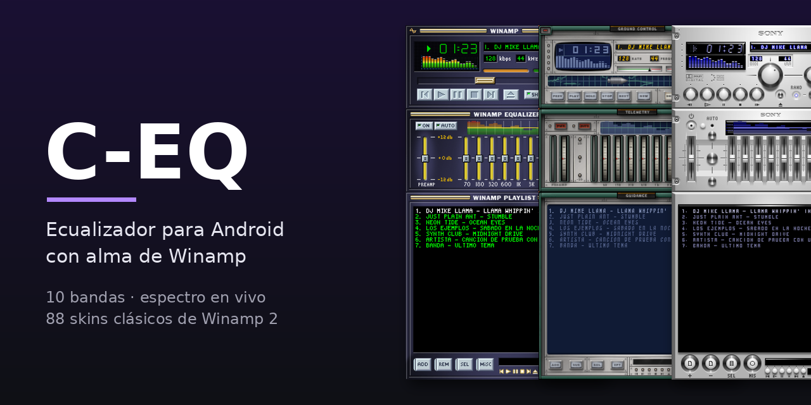
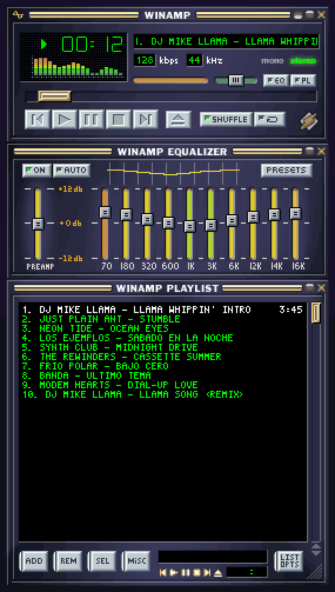
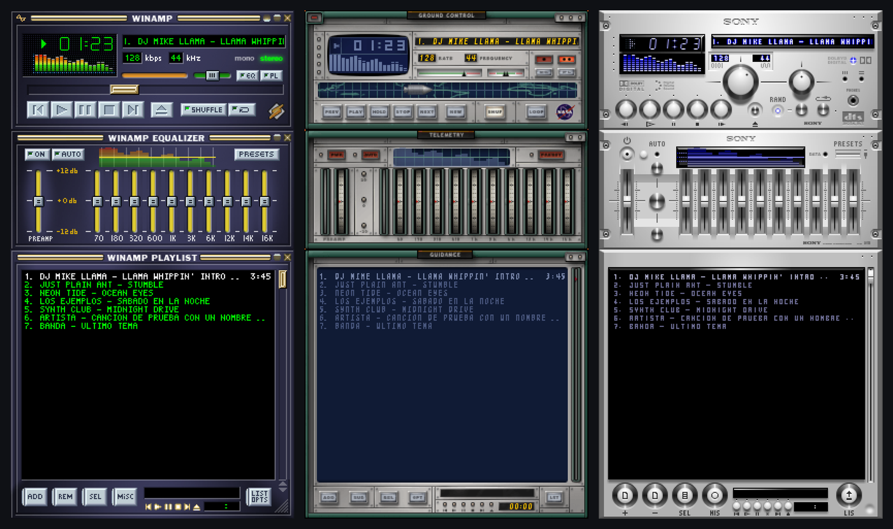
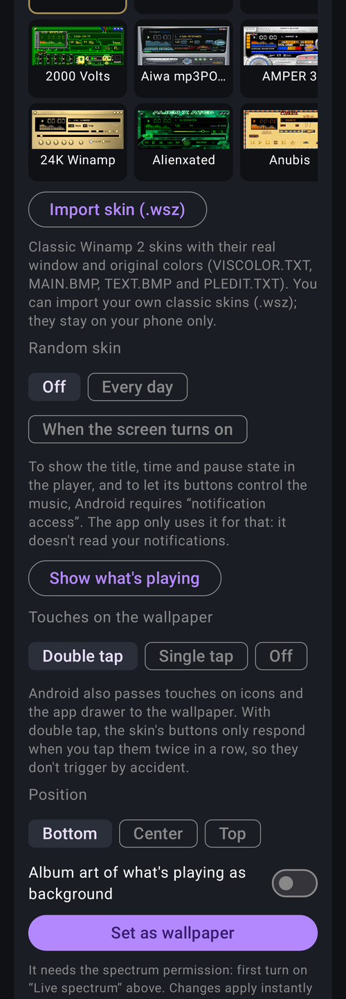
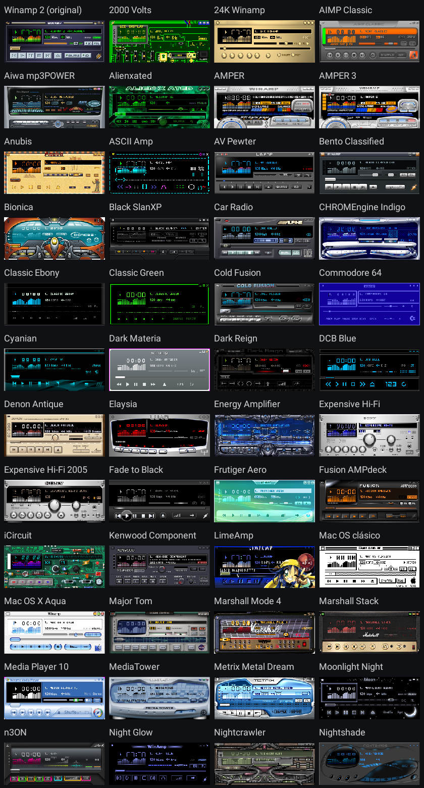
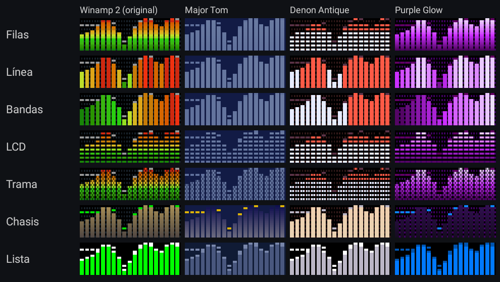
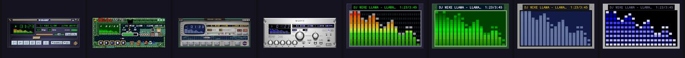
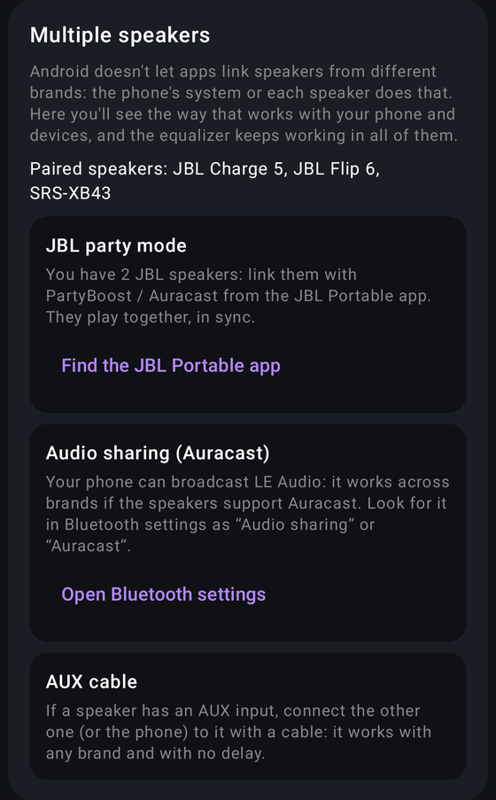
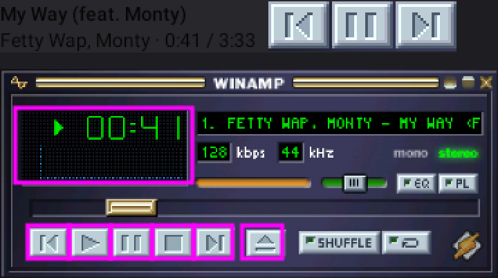

<p align="center">
  
</p>

<p align="center">
  <a href="README.md">🇪🇸 Español</a> · <b>🇬🇧 English</b>
</p>

<p align="center">
  <a href="https://github.com/CarmelitaSoftworks/C-EQ/actions/workflows/android.yml"></a>
  
  
  <a href="LICENSE"></a>
  <a href="https://ko-fi.com/carmelitasoftworks"></a>
</p>

<p align="center">
  <b>A system-wide 10-band equalizer, a live spectrum and the classic Winamp 2 skins<br>
  with their real windows, working buttons and what's playing in real time.</b>
</p>

<p align="center">
  <a href="https://github.com/CarmelitaSoftworks/C-EQ/raw/main/dist/C-EQ.apk"><b>⬇️ Download APK (3.4)</b></a>
  &nbsp;·&nbsp; <a href="https://github.com/CarmelitaSoftworks/C-EQ/releases">All versions</a>
  &nbsp;·&nbsp; <a href="CHANGELOG.md">Changelog</a>
  &nbsp;·&nbsp; <a href="CREDITS.md">Credits</a>
  &nbsp;·&nbsp; <a href="https://ko-fi.com/carmelitasoftworks">Support ☕</a>
</p>

<p align="center">
  
</p>

> The app's menu follows your phone's language: English, or Spanish if your phone is in Spanish.
> The skins, the player and the wallpaper look the same in any language.

---

## ✨ What's new

**3.4 — Shade bar and album art.** Winamp's folded window ("shade") as a wallpaper and a one-row
widget, the spectrum of what's playing behind the skin's equalizer, album art in the app, the
notification and as the wallpaper, and double-tap wallpaper touches so they don't trigger by accident.

**3.3 — Measured headphones and more Winamp.** AutoEQ curves for 48 popular Bluetooth headphones,
a working PRESETS button on the skin, Winamp preset import (.eqf and .q1), 13 new presets, a player
widget with the skin, random skin, surround sound and new-version reminders without Internet.

**3.2.1 — Device names in your language.** Profile and device names follow the phone's language too.

**3.2 — Multiple speakers.** An assistant looks at your paired speakers and your phone and takes you
to the way of using two or more that actually works: the brand's party mode, Audio sharing
(Auracast), Dual audio on Samsung or an AUX cable.

**3.1 — English and Spanish.** The menu follows your phone's language.

**3.0 — Full Winamp.**
- **Full Winamp on your wallpaper**: the skin stacked downwards with the player, the equalizer and
  the playlist. The bands, ON and AUTO respond to touch; the playlist shows the queue of what's
  playing in the skin's own font, and tapping a song jumps to it.
- **Mic-free automatic mode**: the curve follows the connected device, what's playing and the
  volume on its own.
- **Bluetooth LE Audio** headphones and speakers and **HDMI** TVs are recognized.
- Shuffle shown as on in every skin; credits and Ko-fi inside the app.

<p align="center">
  
</p>

## 🎚️ What it does

<table>
<tr>
<td width="50%" valign="top">

### Equalizer
- **10 bands** (31 Hz to 16 kHz) for all the music on your phone, with a limiter so it doesn't clip.
- **One profile per device**: phone speaker, wired headphones, each Bluetooth speaker or headset.
- **Mic-free automatic mode**: starts from the device's curve and adapts it to what's playing
  (music, bass-heavy music, acoustic, speech or video) and to the volume (more bass and treble at
  low volume; protects small speakers and your ears at high volume).
- **Measured AutoEQ curves** for 48 popular Bluetooth headphones (Sony, AirPods Pro 2/Max, Galaxy
  Buds, Bose, JBL, Sennheiser, Beats, Pixel Buds, Nothing, Soundcore, Jabra…): the model is
  recognized when it connects and its sound is corrected.
- **23 presets** (Rock, Pop, Reggaeton, Electronic, Jazz, Movies, Night…), your own ones and
  **Winamp's** (.eqf and winamp.q1).
- **Microphone calibration** for speakers, undo and A/B comparison.
- **Surround sound** on phones that allow it.
- Bass boost **without losing volume**, extra volume and balance.
- Export and import curves in **GraphicEQ** format (Equalizer APO, AutoEQ).

</td>
<td width="50%" valign="top">

</td>
</tr>
</table>

### Winamp skins
- **88 classic skins** with their original window: title bar, buttons, seek bar, volume, the
  skin's font and the visualizer inside its frame. You can also **import `.wsz` files**.
- **Now playing, live**: title, artist, clock, seek bar and volume. The buttons, seek bar and volume
  all work.
- **Color patterns** for the visualizer and an **app theme** taken from the skin.

<p align="center">
  
  
</p>

### Live wallpaper
Your photo at full resolution (or the album art of what's playing) with the spectrum at 60 frames
per second, in four modes: **Player**, **Full Winamp**, **Bar (shade)** or **Spectrum only**. The
skin's buttons work right from the home screen, with a double tap so they don't trigger by accident.

<p align="center">
  
</p>

<p align="center">
  
</p>

### Multiple speakers
Android doesn't let an app link speakers from different brands: the phone's system or each speaker
does that. The assistant looks at your paired speakers and your phone and shows you what works, with
a button to the brand's app or to Bluetooth settings:

- **The brand's party mode** if you have two or more of the same one: Sony Party Connect, JBL
  PartyBoost, UE PartyUp, Soundcore PartyCast, Marshall Stack Mode, Bose and Tribit.
- **Audio sharing (Auracast)** if your phone broadcasts LE Audio: it works across compatible brands.
- **Dual audio** on Samsung phones, with any brand.
- **AUX cable**, which always works.

The equalizer keeps working in all of them.

<p align="center">
  
</p>

### Player in the notification shade
Like Spotify's, but with the window of the chosen skin and its buttons.

<p align="center">
  
</p>

It also comes with a **player widget** with the skin and its buttons, a spectrum **widget**, a **random skin** (every day or when the screen turns on) and a **Quick Settings tile** to turn the equalizer on
without opening the app.

### Languages
The menu follows your phone's language: **English** or **Spanish**. On Android 13+ you can also pick
it in Settings › App languages.

## 📲 Install

1. Download [**C-EQ.apk**](https://github.com/CarmelitaSoftworks/C-EQ/raw/main/dist/C-EQ.apk)
   (Android 8.0 or later).
2. Open it and allow installing apps from that source if Android asks.
   If a Play Protect warning shows up, read [why it warns](#play-protect).
3. Updates install over the previous version without losing your settings.

APK 3.4 SHA-256: `181d9a9850615e4e531c153d7c612767063befa7abd5dae30cd50338b6088d41`

### Permissions

| Permission | What for |
|---|---|
| Microphone (`RECORD_AUDIO`) | Reading the audio output to draw the spectrum (nothing is recorded) and the optional calibration. |
| Notification access | Knowing what's playing, showing the queue and controlling the player (media sessions). Your notifications are not read. |
| Notifications | Showing the player in the notification shade. |
| Bluetooth | Recognizing the connected device to use its profile. |
| Foreground service / start at boot | Keeping the equalizer active and turning it back on after a reboot. |

<a id="play-protect"></a>

### 🛡️ Why does Play Protect warn?

A Google Play Protect warning may appear when installing. It's not because C-EQ does anything bad:

- **It comes from outside Google Play**, from an independent developer Google doesn't know yet.
- **It asks for permissions Google watches closely** (microphone, notification access and a
  foreground service). An equalizer with a spectrum that shows what's playing needs them, but
  spyware uses them too, so the combination triggers the warning.

The key point: **C-EQ has no Internet permission.** Android won't let it send anything off your
phone: not the audio, not what you listen to, not your notifications. It has no ads, tracking or
accounts, and all the code is here for you to check.

**To install it:** in the warning, tap **More details › Install anyway**. If it offers **Send app
for scanning**, accept: that way Google reviews it and stops flagging it. You don't need to turn
Play Protect off.

**To check the APK is the original**, compare its fingerprints with these:

| | SHA-256 |
|---|---|
| APK 3.4 | `181d9a9850615e4e531c153d7c612767063befa7abd5dae30cd50338b6088d41` |
| Signing certificate | `e399d964d3de12bc48776c779b65ab49be2ca6ec8eaeb64f4cb8e61d7948b2d0` |

With the Android SDK tools you can also see it doesn't ask for Internet:
`aapt2 dump permissions C-EQ-3.4.apk` (`android.permission.INTERNET` is not listed).

## 🛠️ Build

With JDK 17 and the Android SDK:

```sh
export ANDROID_HOME=/path/to/sdk
./gradlew lintRelease testDebugUnitTest assembleRelease
```

The release APK is unsigned unless there is a `keystore.properties` file at the root (never in git):

```properties
storeFile=release.jks
storePassword=…
keyAlias=…
keyPassword=…
```

## 🎨 Skins (for developers)

- `WinampClassicSkins.kt`: generated by `tools/gen_skins.py` from the colors extracted with
  `tools/chrome.py` from the skins in the Internet Archive "winampskins" collection.
- `app/src/main/assets/skins/<archiveId>.png`: a 275×637 atlas per skin with the main window and its
  pieces (font, digits, play/pause, pressed buttons and volume), the equalizer window with its
  sliders (EQMAIN.BMP) and the playlist pieces (PLEDIT.BMP), built with `WinampWindow` from the
  skin's BMPs. `SkinImportTest.generateClassicWindows` generates them with `-DclassicWszDir`,
  `-DwinampExeBitmaps` (BITMAP resources from winamp.exe, for the base skin) and `-DwindowsOut`. The
  original `.wsz` files are not in the repository.
- Skins imported by the user keep their window and their `.wsz` in the app's files, and are
  rebuilt automatically when the format changes.
- `SkinImportTest.classicImportMatchesBuiltInCatalog` with `-DclassicWszDir=<folders>` checks that
  the importer produces the same colors as the generated catalog.
- `tools/promo.sh` renders the promo GIF and a vertical MP4 with `PromoFramesTest` and ffmpeg.

## 🙌 Credits

Made by [Carmelita Softworks](https://github.com/CarmelitaSoftworks). Winamp belongs to Nullsoft /
Winamp SA; each bundled skin is the work of its author and comes from the Internet Archive
["winampskins"](https://archive.org/details/winampskins) collection. The full list of skins, with a
link to each one, is in [CREDITS.md](CREDITS.md). Not affiliated with Winamp or Llama Group.

## 📄 License

The code is [GPL-3.0](LICENSE). The bundled Winamp skins (windows and colors) still belong to their
authors and are not covered by that license; see [CREDITS.md](CREDITS.md).

## ☕ Support

If you like C-EQ, you can buy me a coffee on [Ko-fi](https://ko-fi.com/carmelitasoftworks). ☕
