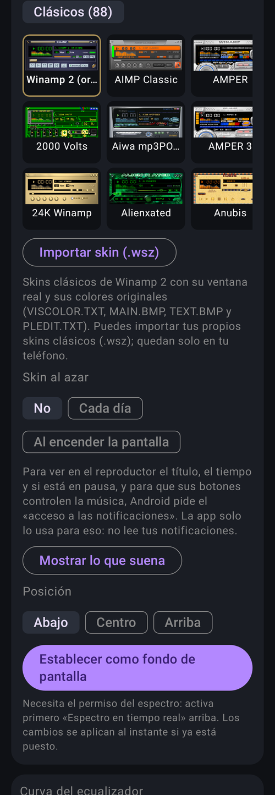
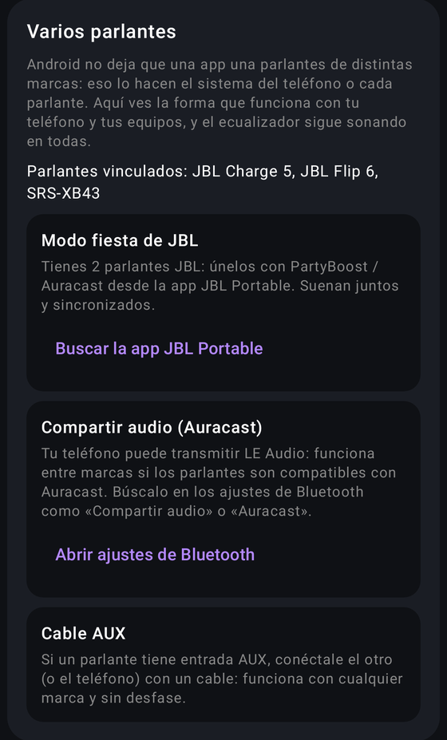

<p align="center">
  
</p>

<p align="center">
  <b>🇪🇸 Español</b> · <a href="README.en.md">🇬🇧 English</a>
</p>

<p align="center">
  <a href="https://github.com/CarmelitaSoftworks/C-EQ/actions/workflows/android.yml"></a>
  
  
  <a href="LICENSE"></a>
  <a href="https://ko-fi.com/carmelitasoftworks"></a>
</p>

<p align="center">
  <b>Ecualizador de 10 bandas para todo el teléfono, espectro en vivo y los skins clásicos de Winamp 2<br>
  con su ventana real, sus botones funcionando y lo que suena en tiempo real.</b>
</p>

<p align="center">
  <a href="https://github.com/CarmelitaSoftworks/C-EQ/raw/main/dist/C-EQ.apk"><b>⬇️ Descargar APK (3.3)</b></a>
  &nbsp;·&nbsp; <a href="https://github.com/CarmelitaSoftworks/C-EQ/releases">Todas las versiones</a>
  &nbsp;·&nbsp; <a href="CHANGELOG.md">Novedades</a>
  &nbsp;·&nbsp; <a href="CREDITS.md">Créditos</a>
  &nbsp;·&nbsp; <a href="https://ko-fi.com/carmelitasoftworks">Apoyar ☕</a>
</p>

<p align="center">
  
</p>

---

## ✨ Novedades

**3.3 — Audífonos medidos y más Winamp.** Curvas de AutoEQ para 48 audífonos Bluetooth populares,
PRESETS del skin funcionando, importar preajustes de Winamp (.eqf y .q1), 13 preajustes nuevos,
widget del reproductor con el skin, skin al azar, sonido envolvente y aviso de versión nueva sin
Internet.

**3.2.1 — Nombres de equipos en tu idioma.** Los nombres del perfil y del equipo conectado también siguen el idioma del teléfono.

**3.2 — Varios parlantes.** Un asistente revisa tus parlantes vinculados y tu teléfono y te lleva a
la forma de usar dos o más que sí funciona: el modo fiesta de la marca, Compartir audio (Auracast),
Audio dual en Samsung o un cable AUX.

**3.1 — Inglés y español.** El menú sigue el idioma del teléfono.

**3.0 — Winamp completo.**
- **Winamp completo en el fondo de pantalla**: el skin hacia abajo con el reproductor, el
  ecualizador y la lista de reproducción. Las bandas, ON y AUTO se tocan; la lista muestra la cola
  de lo que suena con la letra del propio skin, y tocar una canción salta a ella.
- **Ajuste automático sin micrófono**: la curva sigue sola al equipo conectado, a lo que suena y al
  volumen.
- Audífonos y parlantes **Bluetooth LE Audio** y TV por **HDMI** reconocidos.
- Aleatorio encendido en todos los skins, créditos y Ko-fi dentro de la app.

<p align="center">
  
</p>

## 🎚️ Qué hace

<table>
<tr>
<td width="50%" valign="top">

### Ecualizador
- **10 bandas** (31 Hz a 16 kHz) para toda la música del teléfono, con limitador para no saturar.
- **Un perfil por equipo**: altavoz, audífonos con cable, cada parlante o audífono Bluetooth.
- **Ajuste automático sin micrófono**: parte de la curva del equipo y la ajusta a lo que suena
  (música, música con graves, acústica, voz o video) y al volumen (más graves y agudos a poco
  volumen; cuida parlantes chicos y oídos a mucho volumen).
- **Curvas medidas de AutoEQ** para 48 audífonos Bluetooth populares (Sony, AirPods Pro 2/Max,
  Galaxy Buds, Bose, JBL, Sennheiser, Beats, Pixel Buds, Nothing, Soundcore, Jabra…): al
  conectarlos se reconoce el modelo y se corrige su sonido.
- **23 preajustes** (Rock, Pop, Reggaetón, Electrónica, Jazz, Cine, Noche…), los tuyos propios y los
  de **Winamp** (.eqf y winamp.q1).
- **Calibración con micrófono** para parlantes, deshacer y comparación A/B.
- **Sonido envolvente** en los teléfonos que lo permiten.
- Refuerzo de graves **sin perder volumen**, volumen extra y balance.
- Exporta e importa curvas en formato **GraphicEQ** (Equalizer APO, AutoEQ).

</td>
<td width="50%" valign="top">

</td>
</tr>
</table>

### Skins de Winamp
- **88 skins clásicos** con su ventana original: barra de título, botones, posición, volumen, fuente
  del skin y el visor dentro de su recuadro. También se **importan archivos `.wsz`**.
- **Lo que suena en vivo**: título, artista, reloj, barra de posición y volumen. Los botones,
  la posición y el volumen funcionan.
- **Patrones de color** del visor y **tema de la app** tomado del skin.

<p align="center">
  
  
</p>

### Fondo de pantalla animado
Tu foto en resolución completa con el espectro a 60 cuadros por segundo, en tres modos:
**Reproductor**, **Winamp completo** o **Solo el espectro**. Los botones del skin se tocan desde la
pantalla de inicio.

<p align="center">
  
</p>

### Varios parlantes
Android no deja que una app una parlantes de distintas marcas: eso lo hacen el sistema del teléfono
o cada parlante. El asistente revisa tus parlantes vinculados y tu teléfono y te muestra lo que
funciona, con un botón a la app de la marca o a los ajustes de Bluetooth:

- **Modo fiesta de la marca** si tienes dos o más de la misma: Sony Party Connect, JBL PartyBoost,
  UE PartyUp, Soundcore PartyCast, Marshall Stack Mode, Bose y Tribit.
- **Compartir audio (Auracast)** si tu teléfono transmite LE Audio: funciona entre marcas compatibles.
- **Audio dual** en teléfonos Samsung, con cualquier marca.
- **Cable AUX**, que siempre funciona.

El ecualizador sigue sonando en todas.

<p align="center">
  
</p>

### Reproductor en la barra de notificaciones
Como el de Spotify, pero con la ventana del skin elegido y sus botones.

<p align="center">
  
</p>

También trae un **widget del reproductor** con el skin y sus botones, **widget** con el espectro, **skin al azar** (cada día o al encender la pantalla) y **mosaico de Ajustes rápidos** para encender el
ecualizador sin abrir la app.

### Idiomas
El menú sigue el idioma del teléfono: **español** o **inglés**. En Android 13 o superior también se
elige en Ajustes › Idioma de las apps.

## 📲 Instalar

1. Descarga [**C-EQ.apk**](https://github.com/CarmelitaSoftworks/C-EQ/raw/main/dist/C-EQ.apk)
   (Android 8.0 o superior).
2. Ábrelo y permite instalar apps de esa fuente si Android lo pide.
   Si aparece un aviso de Play Protect, lee [por qué avisa](#play-protect).
3. Actualiza encima de la versión anterior sin perder tus ajustes.

SHA-256 del APK 3.3: `571be1ca2938e258dcf9154363589fd1c84e658c28c293f1f398dec1b223acc6`

### Permisos

| Permiso | Para qué |
|---|---|
| Micrófono (`RECORD_AUDIO`) | Leer la salida de audio para dibujar el espectro (no graba nada) y la calibración opcional. |
| Acceso a notificaciones | Saber qué suena, ver la cola y controlar el reproductor (sesiones multimedia). No lee tus notificaciones. |
| Notificaciones | Mostrar el reproductor en la barra. |
| Bluetooth | Reconocer el equipo conectado para usar su perfil. |
| Servicio en primer plano / al iniciar | Mantener el ecualizador activo y encenderlo al reiniciar. |

<a id="play-protect"></a>

### 🛡️ ¿Por qué avisa Play Protect?

Al instalar puede aparecer un aviso de Google Play Protect. No es porque C-EQ haga algo malo:

- **Viene de fuera de Google Play**, de un desarrollador independiente que Google aún no conoce.
- **Pide permisos que Google vigila de cerca** (micrófono, acceso a notificaciones y servicio en
  primer plano). Son los que necesita un ecualizador con espectro que muestra lo que suena, pero
  también los usan apps espía, así que el aviso salta por la combinación.

Lo importante: **C-EQ no tiene permiso de Internet.** Android no le deja enviar nada fuera del
teléfono: ni audio, ni lo que escuchas, ni tus notificaciones. No tiene anuncios, rastreo ni cuentas,
y todo el código está aquí para revisarlo.

**Para instalarla:** en el aviso toca **«Más detalles» › «Instalar de todas formas»**. Si te ofrece
**«Enviar app para análisis»**, acepta: así Google la revisa y deja de marcarla. No hace falta
desactivar Play Protect.

**Para comprobar que el APK es el original**, compara sus huellas con estas:

| | SHA-256 |
|---|---|
| APK 3.3 | `571be1ca2938e258dcf9154363589fd1c84e658c28c293f1f398dec1b223acc6` |
| Certificado de firma | `e399d964d3de12bc48776c779b65ab49be2ca6ec8eaeb64f4cb8e61d7948b2d0` |

Con las herramientas del SDK de Android también puedes ver que no pide Internet:
`aapt2 dump permissions C-EQ-3.3.apk` (no aparece `android.permission.INTERNET`).

## 🛠️ Compilar

Con JDK 17 y el SDK de Android:

```sh
export ANDROID_HOME=/ruta/al/sdk
./gradlew lintRelease testDebugUnitTest assembleRelease
```

El APK de release sale sin firmar salvo que exista `keystore.properties` en la raíz (nunca en git):

```properties
storeFile=release.jks
storePassword=…
keyAlias=…
keyPassword=…
```

## 🎨 Skins (para desarrollar)

- `WinampClassicSkins.kt`: generado por `tools/gen_skins.py` a partir de los colores extraídos con
  `tools/chrome.py` de los skins de la colección «winampskins» de Internet Archive.
- `app/src/main/assets/skins/<archiveId>.png`: atlas de 275×637 de cada skin con la ventana principal
  y sus piezas (fuente, dígitos, reproducir/pausa, botones presionados y volumen), la ventana del
  ecualizador con sus deslizadores (EQMAIN.BMP) y las piezas de la lista (PLEDIT.BMP), armado con
  `WinampWindow` a partir de sus BMP. Las genera `SkinImportTest.generateClassicWindows` con
  `-DclassicWszDir`, `-DwinampExeBitmaps` (recursos BITMAP de winamp.exe, para el skin base) y
  `-DwindowsOut`. Los `.wsz` originales no están en el repositorio.
- Los skins que importa el usuario guardan su ventana y el `.wsz` en los archivos de la app, y se
  actualizan solos cuando cambia el formato.
- `SkinImportTest.classicImportMatchesBuiltInCatalog` con `-DclassicWszDir=<carpetas>` comprueba que
  el importador da los mismos colores que el catálogo generado.

## 🙌 Créditos

Hecho por [Carmelita Softworks](https://github.com/CarmelitaSoftworks). Winamp es de Nullsoft /
Winamp SA; cada skin incluido es obra de su autor o autora y viene de la colección
[«winampskins»](https://archive.org/details/winampskins) de Internet Archive. La lista completa de
skins, con el enlace a cada uno, está en [CREDITS.md](CREDITS.md).

## 📄 Licencia

El código es [GPL-3.0](LICENSE). Los skins de Winamp incluidos (ventanas y colores) siguen siendo
de sus autores y no quedan bajo esa licencia; ver [CREDITS.md](CREDITS.md).

## ☕ Apoyar

Si C-EQ te gusta, puedes invitar un café en [Ko-fi](https://ko-fi.com/carmelitasoftworks). ☕

---

🇬🇧 **English version:** [README.en.md](README.en.md)
