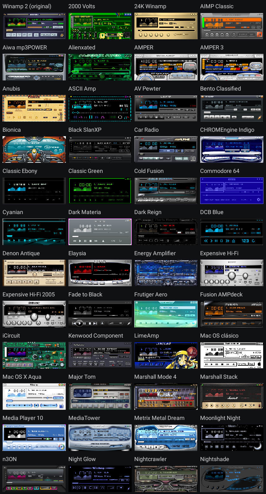
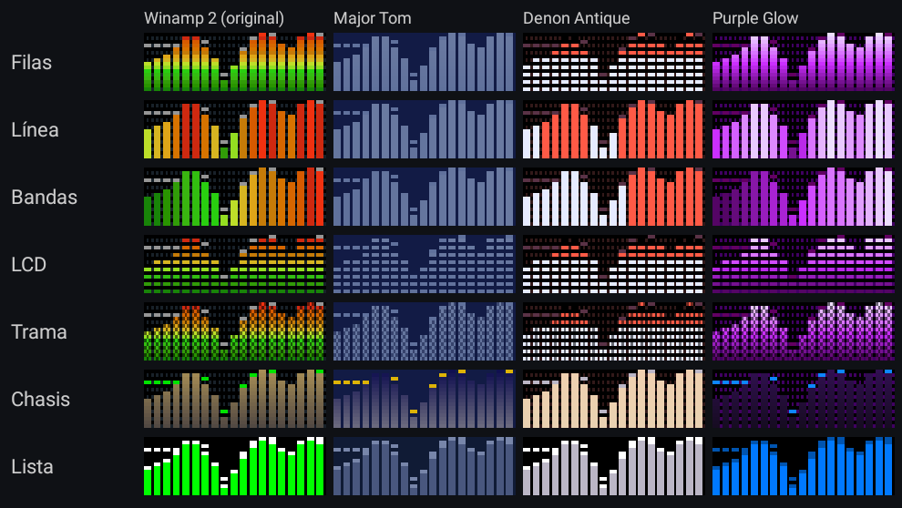
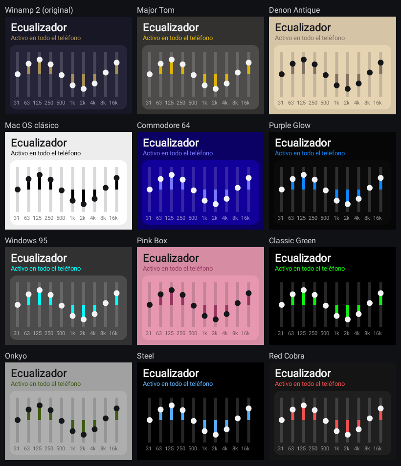
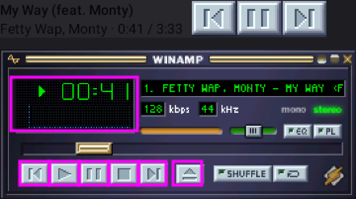
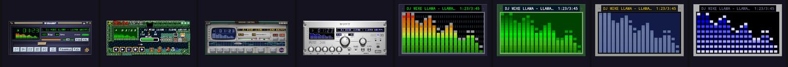
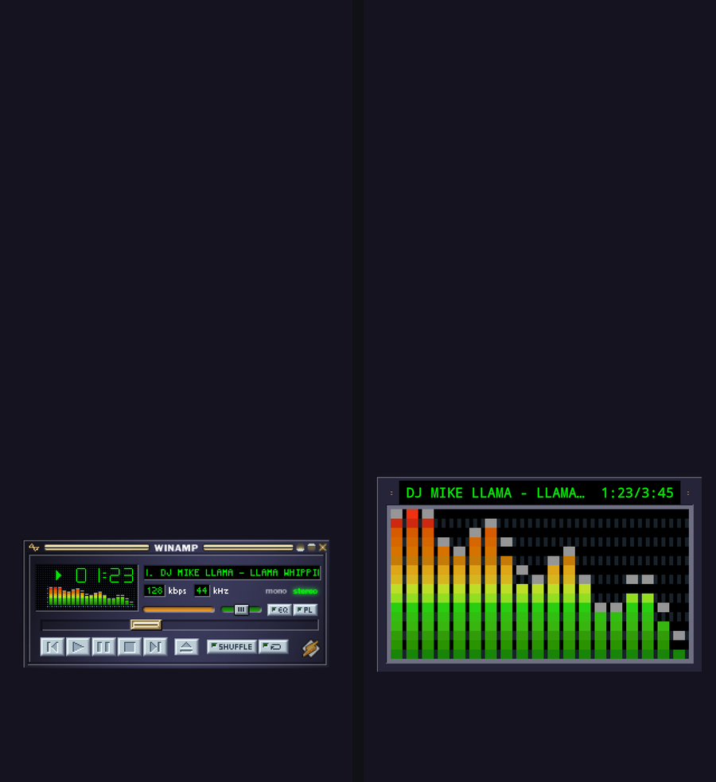

# C-EQ

Ecualizador para Android con alma de Winamp: 10 bandas para todo el teléfono, visor de espectro en
tiempo real, fondo de pantalla animado, widget, mosaico de ajustes rápidos y los skins clásicos de
Winamp 2 con su ventana real, botones que funcionan y lo que suena en vivo.

[](https://ko-fi.com/carmelitasoftworks)


## Qué hace

- **Ecualizador de 10 bandas** para toda la música del teléfono, con perfiles por dispositivo
  (parlante, audífonos, Bluetooth), calibración y refuerzo de graves sin perder volumen.
- **Visor de espectro** en la app, en el widget y en el fondo de pantalla.
- **88 skins clásicos de Winamp** con su ventana original (barra de título, botones, posición,
  volumen y fuente del skin) y el visor dentro de su recuadro. También se pueden **importar
  archivos `.wsz`** clásicos.

  

- **Patrones de color** del visor y **tema de la app** tomado del skin elegido.

   

- **Lo que suena, en vivo**: título, artista, reloj, barra de posición y volumen en la ventana del
  skin. Los botones (anterior, reproducir, pausa, detener, siguiente), la barra de posición y el
  volumen funcionan, también desde el fondo de pantalla.
- **Reproductor en la barra de notificaciones**, como el de Spotify, con la ventana del skin.

  

- **Fondo animado** con tu foto en resolución completa y dos modos: el reproductor completo o solo
  el espectro.

  
  

## Instalar

Descarga el APK de la última compilación en
[Actions](https://github.com/CarmelitaSoftworks/C-EQ/actions) (artefacto `apk`) o compílalo tú.
Requiere Android 8.0 o superior.

### Permisos

| Permiso | Para qué |
|---|---|
| Micrófono (`RECORD_AUDIO`) | Leer la salida de audio para dibujar el espectro (no graba nada). |
| Acceso a notificaciones | Saber qué suena y controlar el reproductor (sesiones multimedia). |
| Notificaciones | Mostrar el reproductor en la barra. |
| Bluetooth | Reconocer los audífonos para usar su perfil del ecualizador. |
| Servicio en primer plano / al iniciar | Mantener el ecualizador activo y encenderlo al reiniciar. |

## Compilar

Con JDK 17 y el SDK de Android:

```sh
export ANDROID_HOME=/ruta/al/sdk
./gradlew lintRelease testDebugUnitTest assembleRelease
```

El APK de release sale sin firmar salvo que exista `keystore.properties` en la raíz (nunca en git):

```properties
storeFile=release.jks
storePassword=…
keyAlias=…
keyPassword=…
```

## Skins

- `WinampClassicSkins.kt`: generado por `tools/gen_skins.py` a partir de los colores extraídos con
  `tools/chrome.py` de los skins de la colección «winampskins» de Internet Archive.
- `app/src/main/assets/skins/<archiveId>.png`: la ventana principal (275×116) de cada skin y, debajo,
  sus piezas (fuente, dígitos, reproducir/pausa, botones presionados y volumen), armadas con
  `WinampWindow` a partir de sus BMP. Las genera `SkinImportTest.generateClassicWindows` con
  `-DclassicWszDir`, `-DwinampExeBitmaps` (recursos BITMAP de winamp.exe, para el skin base) y
  `-DwindowsOut`. Los `.wsz` originales no están en el repositorio.
- Los skins que importa el usuario guardan su ventana y el `.wsz` en los archivos de la app, y se
  actualizan solos cuando cambia el formato.
- `SkinImportTest.classicImportMatchesBuiltInCatalog` con `-DclassicWszDir=<carpetas>` comprueba que
  el importador da los mismos colores que el catálogo generado.

## Créditos

Hecho por [Carmelita Softworks](https://github.com/CarmelitaSoftworks). Winamp es de Nullsoft /
Winamp SA; cada skin incluido es obra de su autor o autora y viene de la colección
[«winampskins»](https://archive.org/details/winampskins) de Internet Archive. La lista completa de
skins, con el enlace a cada uno, está en [CREDITS.md](CREDITS.md).

## Licencia

El código es [GPL-3.0](LICENSE). Los skins de Winamp incluidos (ventanas y colores) siguen siendo
de sus autores y no quedan bajo esa licencia; ver [CREDITS.md](CREDITS.md).

## Apoyar

Si C-EQ te gusta, puedes invitar un café en [Ko-fi](https://ko-fi.com/carmelitasoftworks). ☕
