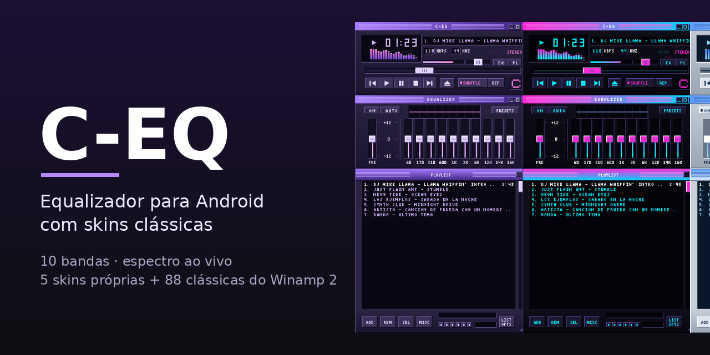
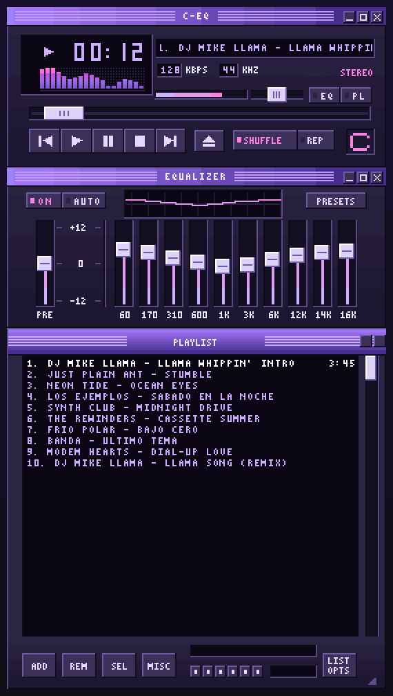
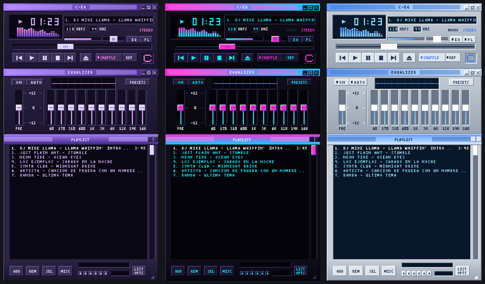
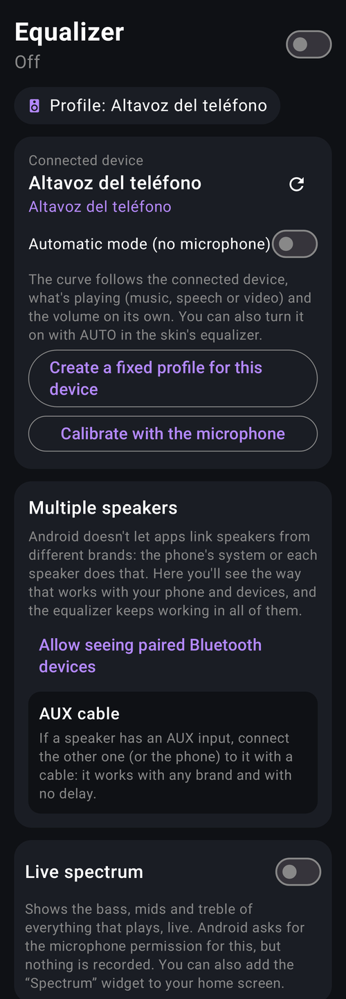
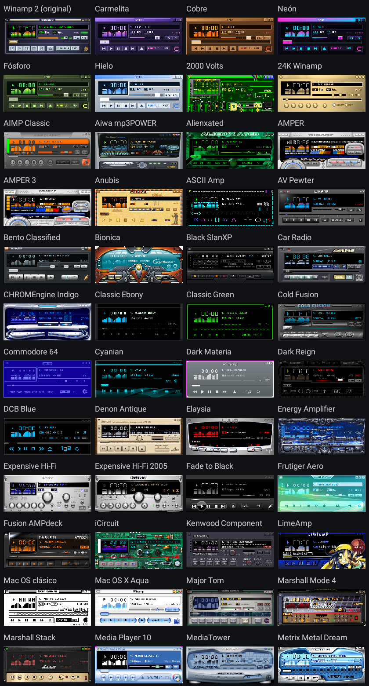
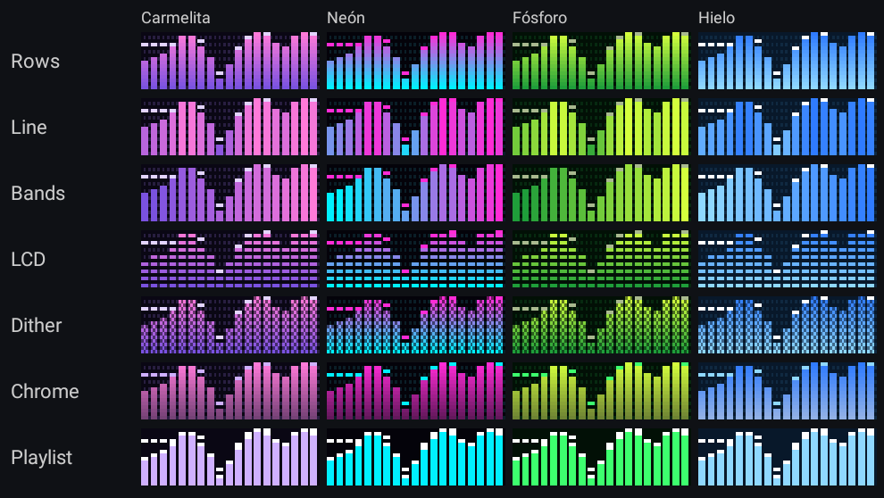
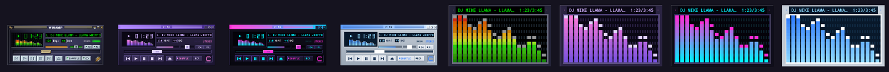
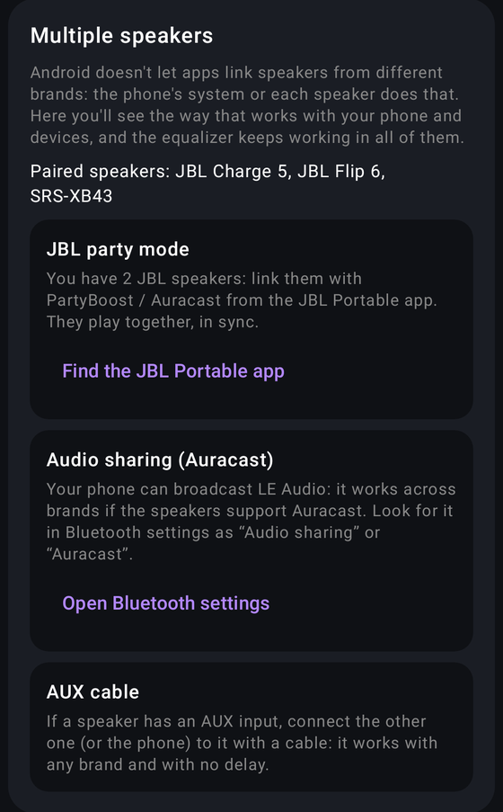
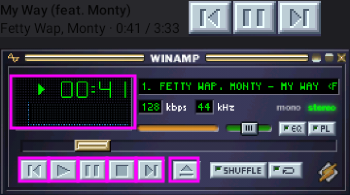

<p align="center">
  
</p>

<p align="center">
  <a href="README.md">🇪🇸 Español</a> · <a href="README.en.md">🇬🇧 English</a> · <b>🇧🇷 Português</b>
</p>

<p align="center">
  <a href="https://github.com/CarmelitaSoftworks/C-EQ/actions/workflows/android.yml"></a>
  
  
  <a href="LICENSE"></a>
  <a href="https://ko-fi.com/carmelitasoftworks"></a>
</p>

<p align="center">
  <b>Um equalizador de 10 bandas para todo o telefone, um espectro ao vivo e as skins clássicas do Winamp 2<br>
  com suas janelas reais, botões que funcionam e o que está tocando em tempo real.</b>
</p>

<p align="center">
  <a href="https://github.com/CarmelitaSoftworks/C-EQ/raw/main/dist/C-EQ.apk"><b>⬇️ Baixar APK (3.7)</b></a>
  &nbsp;·&nbsp; <a href="https://github.com/CarmelitaSoftworks/C-EQ/releases">Todas as versões</a>
  &nbsp;·&nbsp; <a href="CHANGELOG.md">Novidades</a>
  &nbsp;·&nbsp; <a href="CREDITS.md">Créditos</a>
  &nbsp;·&nbsp; <a href="#como-foi-feito">Como foi feito</a>
  &nbsp;·&nbsp; <a href="https://ko-fi.com/carmelitasoftworks">Apoiar ☕</a>
</p>

<p align="center">
  
</p>

> O menu do app segue o idioma do seu telefone: português, espanhol ou inglês.
> As skins, o player e o papel de parede ficam iguais em qualquer idioma.

---

## ✨ Novidades

**3.7 — Ajuste por app, português e skins próprias.** Uma predefinição que se soma à curva enquanto cada app toca (mais graves no Spotify, vozes mais claras nos podcasts), o app em português e cinco skins originais do C-EQ: Carmelita, Cobre, Neón, Fósforo e Hielo.

**3.6 — Backup, acessibilidade e tudo traduzido.** Salve e restaure todos os seus ajustes e skins em um .zip, o equalizador funciona com o TalkBack (cada banda é lida em voz alta e pode ser ajustada) e o app inteiro, incluindo notificações e widget, segue o idioma do telefone.

**3.5 — Menos bateria e guia de boas-vindas.** O papel de parede animado a 30 ou 60 fps e pausado quando nada está tocando, um guia de boas-vindas com as permissões em ordem e o espectro atrás do equalizador da skin como opção.

**3.4.1 — Sem distorção no alto-falante do telefone.** Um limitador mais firme e proteção do alto-falante do telefone.

**3.4 — Barra recolhida e capas.** A janela recolhida do Winamp ("shade") como papel de parede e como
widget de uma linha, o espectro do que está tocando atrás do equalizador da skin, a capa do álbum no
app, na notificação e como papel de parede, e toques duplos no papel de parede para não dispararem
sem querer.

**3.3 — Fones medidos e mais Winamp.** Curvas AutoEQ para 48 fones Bluetooth populares, o botão
PRESETS funcionando na skin, importação de predefinições do Winamp (.eqf e .q1), 13 predefinições
novas, um widget de player com a skin, skin aleatória, som surround e lembretes de versão nova sem
Internet.

**3.2.1 — Nomes dos aparelhos no seu idioma.** Os nomes de perfis e aparelhos também seguem o idioma do telefone.

**3.2 — Várias caixas de som.** Um assistente olha suas caixas pareadas e seu telefone e leva você ao
jeito de usar duas ou mais que realmente funciona: o modo festa da marca, o Compartilhamento de áudio
(Auracast), o Áudio duplo da Samsung ou um cabo AUX.

**3.1 — Inglês e espanhol.** O menu segue o idioma do telefone.

**3.0 — Winamp completo.**
- **Winamp completo no papel de parede**: a skin empilhada para baixo com o player, o equalizador e a
  playlist. As bandas, ON e AUTO respondem ao toque; a playlist mostra a fila do que está tocando com a
  fonte da própria skin, e tocar em uma música pula para ela.
- **Modo automático sem microfone**: a curva acompanha sozinha o aparelho conectado, o que está tocando
  e o volume.
- São reconhecidos fones e caixas **Bluetooth LE Audio** e TVs por **HDMI**.
- Aleatório aparece ligado em todas as skins; créditos e Ko-fi dentro do app.

<p align="center">
  
</p>

## 🎚️ O que faz

<table>
<tr>
<td width="50%" valign="top">

### Equalizador
- **10 bandas** (31 Hz a 16 kHz) para toda a música do telefone, com limitador para não saturar.
- **Um perfil por aparelho**: alto-falante do telefone, fones com fio, cada caixa ou fone Bluetooth.
- **Modo automático sem microfone**: parte da curva do aparelho e a adapta ao que está tocando
  (música, música com muito grave, acústica, voz ou vídeo) e ao volume (mais graves e agudos com
  volume baixo; protege caixas pequenas e seus ouvidos com volume alto).
- **Curvas AutoEQ medidas** para 48 fones Bluetooth populares (Sony, AirPods Pro 2/Max, Galaxy
  Buds, Bose, JBL, Sennheiser, Beats, Pixel Buds, Nothing, Soundcore, Jabra…): o modelo é reconhecido
  ao conectar e seu som é corrigido.
- **23 predefinições** (Rock, Pop, Reggaeton, Eletrônica, Jazz, Filmes, Noite…), as suas próprias e
  as do **Winamp** (.eqf e winamp.q1).
- **Ajuste por app**: uma predefinição que se soma à curva enquanto esse app toca (mais graves no
  Spotify, vozes mais claras nos podcasts…).
- **Calibração com microfone** para caixas de som, desfazer e comparação A/B.
- **Som surround** nos telefones que permitem.
- Reforço de graves **sem perder volume**, volume extra e balanço.
- Exporte e importe curvas no formato **GraphicEQ** (Equalizer APO, AutoEQ).

</td>
<td width="50%" valign="top">

</td>
</tr>
</table>

### Skins do Winamp
- **88 skins clássicas** com sua janela original: barra de título, botões, barra de posição, volume,
  fonte da skin e o visualizador dentro da moldura. Também é possível **importar arquivos `.wsz`**.
- **5 skins originais do C-EQ** (Carmelita, Cobre, Neón, Fósforo e Hielo), também como
  [`.wsz`](skins/) para qualquer player clássico.
- **O que está tocando, ao vivo**: título, artista, relógio, barra de posição e volume. Os botões, a
  barra de posição e o volume funcionam.
- **Padrões de cores** do visualizador e um **tema do app** tirado da skin.

<p align="center">
  
  
</p>

### Papel de parede animado
Sua foto em resolução total (ou a capa do que está tocando) com o espectro a 60 quadros por segundo,
em quatro modos: **Player**, **Winamp completo**, **Barra (recolhida)** ou **Só o espectro**. Os botões
da skin funcionam direto da tela inicial, com toque duplo para não dispararem sem querer.

<p align="center">
  
</p>

<p align="center">
  
</p>

### Várias caixas de som
O Android não deixa um app unir caixas de som de marcas diferentes: isso é feito pelo sistema do
telefone ou por cada caixa. O assistente olha suas caixas pareadas e seu telefone e mostra o que
funciona, com um botão para o app da marca ou para as configurações de Bluetooth:

- **O modo festa da marca** se você tiver duas ou mais da mesma: Sony Party Connect, JBL PartyBoost,
  UE PartyUp, Soundcore PartyCast, Marshall Stack Mode, Bose e Tribit.
- **Compartilhamento de áudio (Auracast)** se o seu telefone transmite LE Audio: funciona entre marcas
  compatíveis.
- **Áudio duplo** nos telefones Samsung, com qualquer marca.
- **Cabo AUX**, que sempre funciona.

O equalizador continua funcionando em todos.

<p align="center">
  
</p>

### Player na aba de notificações
Como o do Spotify, mas com a janela da skin escolhida e seus botões.

<p align="center">
  
</p>

Também vem com um **widget de player** com a skin e seus botões, um **widget** de espectro, uma
**skin aleatória** (todo dia ou ao ligar a tela) e um **bloco de Configurações rápidas** para ligar o
equalizador sem abrir o app.

### Idiomas
O menu segue o idioma do telefone: **português**, **espanhol** ou **inglês**. No Android 13 ou
superior também dá para escolher em Configurações › Idiomas dos apps.

## 📲 Instalar

1. Baixe o [**C-EQ.apk**](https://github.com/CarmelitaSoftworks/C-EQ/raw/main/dist/C-EQ.apk)
   (Android 8.0 ou superior).
2. Abra-o e permita instalar apps dessa origem se o Android pedir.
   Se aparecer um aviso do Play Protect, leia [por que ele avisa](#play-protect).
3. As atualizações são instaladas por cima da versão anterior sem perder seus ajustes.

SHA-256 do APK 3.7: `9540252a6dc15a1dbd937b7219f5a66b648dcb1200dca0b3f1c68d23ad4686c0`

### Permissões

| Permissão | Para quê |
|---|---|
| Microfone (`RECORD_AUDIO`) | Ler a saída de áudio para desenhar o espectro (nada é gravado) e a calibração opcional. |
| Acesso às notificações | Saber o que está tocando, mostrar a fila e controlar o player (sessões de mídia). Suas notificações não são lidas. |
| Notificações | Mostrar o player na aba de notificações. |
| Bluetooth | Reconhecer o aparelho conectado para usar o perfil dele. |
| Serviço em primeiro plano / iniciar com o sistema | Manter o equalizador ativo e religá-lo depois de reiniciar. |

<a id="play-protect"></a>

### 🛡️ Por que o Play Protect avisa?

Ao instalar, pode aparecer um aviso do Google Play Protect. Não é porque o C-EQ faça algo de ruim:

- **Ele vem de fora do Google Play**, de um desenvolvedor independente que o Google ainda não conhece.
- **Ele pede permissões que o Google vigia de perto** (microfone, acesso às notificações e um serviço
  em primeiro plano). Um equalizador com espectro que mostra o que está tocando precisa delas, mas
  apps espiões também as usam, então a combinação dispara o aviso.

O principal: **o C-EQ não tem permissão de Internet.** O Android não deixa que ele envie nada para fora
do seu telefone: nem o áudio, nem o que você ouve, nem suas notificações. Não tem anúncios, rastreamento
nem contas, e todo o código está aqui para você conferir.

**Para instalar:** no aviso, toque em **Mais detalhes › Instalar mesmo assim**. Se ele oferecer
**Enviar app para verificação**, aceite: assim o Google o analisa e para de marcá-lo. Não é preciso
desativar o Play Protect.

**Para conferir que o APK é o original**, compare as impressões digitais com estas:

| | SHA-256 |
|---|---|
| APK 3.7 | `9540252a6dc15a1dbd937b7219f5a66b648dcb1200dca0b3f1c68d23ad4686c0` |
| Certificado de assinatura | `e399d964d3de12bc48776c779b65ab49be2ca6ec8eaeb64f4cb8e61d7948b2d0` |

Com as ferramentas do SDK do Android também dá para ver que ele não pede Internet:
`aapt2 dump permissions C-EQ-3.7.apk` (`android.permission.INTERNET` não aparece).

## 🛠️ Compilar

Com o JDK 17 e o SDK do Android:

```sh
export ANDROID_HOME=/caminho/para/o/sdk
./gradlew lintRelease testDebugUnitTest assembleRelease
```

O APK de release sai sem assinatura, a menos que exista um arquivo `keystore.properties` na raiz (nunca no git):

```properties
storeFile=release.jks
storePassword=…
keyAlias=…
keyPassword=…
```

## 🎨 Skins (para desenvolvedores)

- `WinampClassicSkins.kt`: gerado por `tools/gen_skins.py` a partir das cores extraídas com
  `tools/chrome.py` das skins da coleção "winampskins" do Internet Archive.
- `app/src/main/assets/skins/<archiveId>.png`: um atlas de 275×637 por skin com a janela principal e
  suas peças (fonte, dígitos, tocar/pausar, botões pressionados e volume), a janela do equalizador com
  seus controles deslizantes (EQMAIN.BMP) e as peças da playlist (PLEDIT.BMP), montado com
  `WinampWindow` a partir dos BMPs da skin. `SkinImportTest.generateClassicWindows` os gera com
  `-DclassicWszDir`, `-DwinampExeBitmaps` (recursos BITMAP do winamp.exe, para a skin base) e
  `-DwindowsOut`. Os `.wsz` originais não estão no repositório.
- **Skins originais do C-EQ** (Carmelita, Cobre, Neón, Fósforo e Hielo): designs próprios, na pasta
  [`skins/`](skins/) como arquivos `.wsz` que funcionam em qualquer player clássico.
  `tools/gen_original_skins.py` os gera (junto com `OriginalSkins.kt`); o app monta as janelas
  `ceq-*.png` a partir do `.wsz` com `OriginalSkinsTest` (`-DoriginalWindowsOut=<pasta>`), que também
  confere se continuam sincronizadas.
- As skins importadas pelo usuário guardam sua janela e seu `.wsz` nos arquivos do app, e são
  remontadas sozinhas quando o formato muda.
- `SkinImportTest.classicImportMatchesBuiltInCatalog` com `-DclassicWszDir=<pastas>` confere se o
  importador dá as mesmas cores que o catálogo gerado.
- `tools/promo.sh` gera o GIF de divulgação e um MP4 vertical com `PromoFramesTest` e ffmpeg, e
  `tools/docs_images.py` monta as imagens deste README a partir das capturas dos testes.

<a id="como-foi-feito"></a>

## 🤖 Como foi feito

O C-EQ foi desenvolvido **com a ajuda de IA**: o código foi escrito pelo Claude (da Anthropic), um
assistente de programação, e por isso os commits o citam como coautor. Não escondemos isso.

O que a IA não fez sozinha:

- **A ideia e as decisões:** o que o app faz, como ele é e o que ele não faz, como não pedir a
  permissão de Internet ou seguir o design original do Winamp.
- **Os testes em um telefone de verdade:** cada versão foi testada em um vivo V30, e os problemas
  encontrados ali (distorção no alto-falante do telefone, toques no papel de parede disparando sem
  querer, o player da aba indo para "Silencioso", skins importadas que não carregavam…) foram
  relatados e corrigidos.
- **A revisão:** antes de lançar, cada versão passa por uma revisão de código e por testes automáticos,
  e os problemas encontrados são corrigidos antes de compilar.

### Você mesmo pode conferir

- **Sem Internet:** `aapt2 dump permissions C-EQ.apk` não lista `android.permission.INTERNET`.
  Nada sai do seu telefone.
- **Código aberto (GPL-3.0):** está tudo neste repositório, inclusive as ferramentas que montam as
  skins e as curvas dos fones.
- **Testes automáticos:** mais de 140, que o GitHub roda a cada mudança (o selo "Build" lá em cima).
- **APK reproduzível e verificável:** cada versão publica seu SHA-256 e o do certificado de assinatura.

Achou um erro ou algo que parece malfeito?
[Abra uma issue](https://github.com/CarmelitaSoftworks/C-EQ/issues): ela é revisada e corrigida.

## 🙌 Créditos

Feito por [Carmelita Softworks](https://github.com/CarmelitaSoftworks). Winamp pertence à Nullsoft /
Winamp SA; cada skin clássica incluída é obra de seu autor ou autora e vem da coleção
["winampskins"](https://archive.org/details/winampskins) do Internet Archive. A lista completa de
skins, com o link de cada uma, está em [CREDITS.md](CREDITS.md). Sem vínculo com o Winamp nem com o
Llama Group.

## 📄 Licença

O código é [GPL-3.0](LICENSE). As skins do Winamp incluídas (janelas e cores) continuam pertencendo a
seus autores e não estão cobertas por essa licença; veja [CREDITS.md](CREDITS.md). As cinco skins
originais do C-EQ fazem parte do projeto e seguem a GPL-3.0.

## ☕ Apoiar

Se você gosta do C-EQ, pode me pagar um café no [Ko-fi](https://ko-fi.com/carmelitasoftworks). ☕
